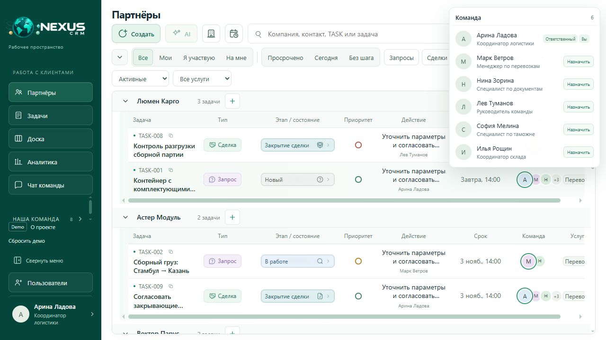
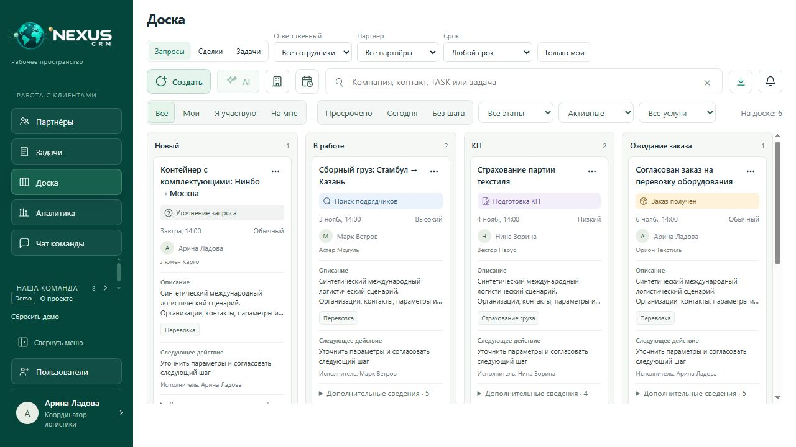

# NEXUS CRM Product Showcase

**[Открыть интерактивное демо](https://rvaksss-art.github.io/crm-product-showcase-nexus/)** · **[Product Case Study](https://rvaksss-art.github.io/crm-product-showcase-nexus/case-study.html)**

Портфолио Business Analyst / Product Owner: автономный прототип логистической CRM. Сохраняет интерфейс NEXUS — таблицы, карточки, статусы, Kanban и анимацию Orbit.

В этом репозитории размещена только собранная минифицированная версия. Поддерживаемые исходники, тесты и инструменты сборки хранятся отдельно в приватном репозитории.

## Что попробовать

1. Создайте партнёра и запрос, добавьте демонстрационный расчёт.
2. Установите запросу состояние «Заказ получен» и конвертируйте его в сделку.
3. Создайте задачу, назначьте сотрудника, измените срок, приоритет и чек-лист.
4. На доске переместите карточку между этапами.
5. Добавьте локальное сообщение, откройте аналитику, обновите страницу.
6. Нажмите «Сбросить демо» для восстановления исходного набора.

Все люди, организации, контакты и расчёты вымышленные. Изменения хранятся только в вашем браузере. Нет регистрации, backend, базы данных и рабочих API. Чаты не доставляют сообщения другим людям; синхронизация, приглашения, авторизация и AI отмечены как недоступные в демо. Метрики вычисляются из текущего набора; измеренные бизнес-эффекты не заявляются.

## Продуктовый кейс

Полный интерактивный кейс доступен по ссылке выше. Он описывает исходный продукт по материалам автора, отдельно от автономного showcase.

| Раздел | Содержание и границы подтверждения |
| --- | --- |
| Business Problem | Разрозненные партнёры, запросы, расчёты, задачи и коммуникации мешают сохранять общий контекст. |
| Discovery | Материалы автора представлены в кейсе. Протоколы интервью и состав респондентов не предоставлены для независимой проверки. |
| Solution Discovery | Реализована связка партнёр → запрос → сделка и самостоятельные задачи. Документированный сравнительный анализ альтернатив требует уточнения. |
| Requirements | Пример User Story: координатор видит запросы партнёра вместе с контекстом. Use Case: запрос → расчёт → заказ → сделка. Business Rule: конвертация после «Заказ получен», один раз. Acceptance Criteria: одна связанная сделка, повторная конвертация отклоняется, результат сохраняется после обновления страницы. |
| Prioritization | При адаптации приоритет отдан исходному интерфейсу и сквозному сценарию, затем поддерживающим операциям. Исторический backlog MVP требует подтверждения. |
| UX/UI | Переиспользованы исходные компоненты и визуальный стиль. Исследовательские протоколы и датированные итерации требуют уточнения. |
| Delivery | AI-assisted разработка с Codex, локальный адаптер, синтетические данные, проверки бизнес-правил и интерфейса, минификация, GitHub Pages. |
| Results | Работают перечисленные демонстрационные сценарии. Улучшение координации и экономия времени — ожидаемые эффекты, не измеренные результаты. |
| My Role | Заявленная автором роль: Business Analysis, Product Ownership, UX, постановка задач AI-агенту, тестирование и координация внедрения. |

## Права и ограничения распространения

Владелец подтвердил разрешение заказчика на публичный показ frontend, интерфейса и бренда NEXUS. Отдельная open-source лицензия на собственные материалы не назначена. Сторонние компоненты сохраняют свои лицензии: [уведомления](THIRD_PARTY_NOTICES.md), [Lucide / Feather](assets/workflow-icons/LICENSE-lucide.txt).

Любой посетитель может загрузить файлы, которые исполняются в браузере. Минификация уменьшает читаемость, но не гарантирует защиту от копирования. Приватными остаются поддерживаемые исходники и их история.

## English

NEXUS CRM Product Showcase is an interactive BA/PO portfolio with partners, requests, quotations, deals, tasks and Kanban. It runs entirely in the browser with fictional data and local storage. There is no backend, real message delivery or multi-user synchronization. Business benefits are expected outcomes, not measured claims. This repository contains compiled, minified demo files; maintained source code is kept privately. Minification does not prevent copying browser-delivered code.

## Screenshots

